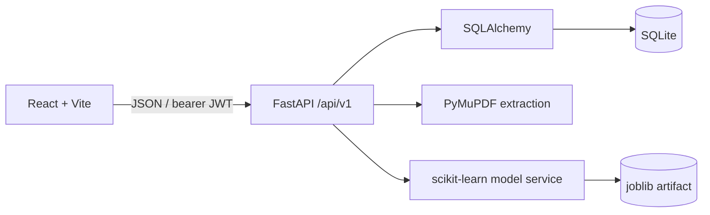
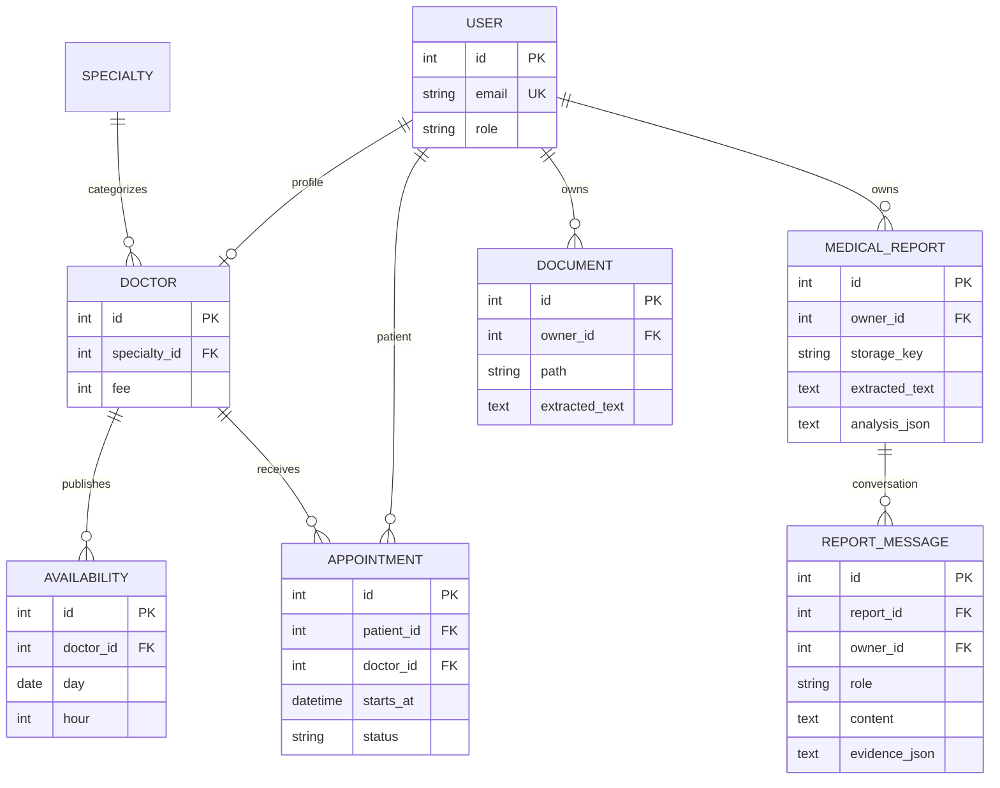

# Architecture and schema

The schema includes User, Specialty, Doctor, Availability, Appointment, ConsultationNote, Notification, Document, MedicalReport, and ReportMessage entities. The report analyzer stores a generated storage key, filename for display, extracted text and deterministic analysis in the local database; generated PDF files live outside the public frontend directory. Report messages and every report access are owner-scoped. Deletion removes linked messages and the local PDF. There is no automatic retention schedule. Notifications are in-app only. An audit-log entity, availability timezone configuration, and Alembic migrations are not implemented yet. Timestamps are stored as naive UTC by the current SQLite setup; API booking normalizes offset-aware incoming timestamps to UTC. A production rollout needs an explicit deployment timezone and migration plan.

Report processing uses PyMuPDF, bounded text normalization and transparent line regexes. These are candidate extractions, not verified clinical facts. Local Q&A retrieves at most five matching snippets from the current report; it does not retrieve another patient's records. Optional Ollama is enabled only when a model is configured and responds at a localhost URL. No startup model download or cloud provider is used. If Ollama is absent, local keyword retrieval remains available. Uploaded PDF text is treated as untrusted data and is never used as instructions. This feature is informational only, has no clinical validation, and has not undergone a privacy-law compliance review.

Backend role and ownership checks guard private routes. The seeded admin can inspect aggregate user and appointment data; patient documents are not included in those aggregates. Doctor access is limited to appointments assigned by doctor ID. The local demo secret has a development fallback and must be overridden before any shared deployment.
